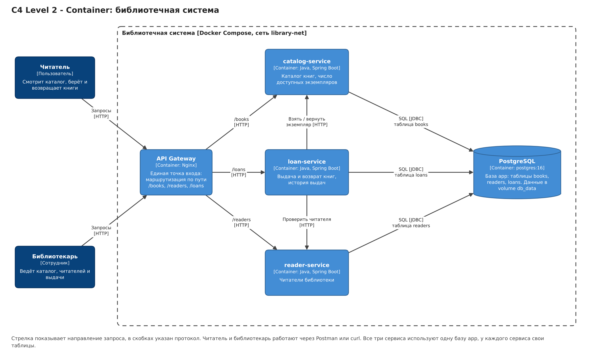

# Библиотека

Небольшая библиотека, написанная как несколько маленьких программ (сервисов), которые работают вместе. В ней можно вести каталог книг, список читателей и записывать, кто какую книгу взял. Всё запускается одной командой.

## Краткая сводка
- **Каталог (`catalog-service`)** знает все книги и сколько экземпляров каждой сейчас есть на полке.
- **Читатели (`reader-service`)** знает всех читателей.
- **Выдачи (`loan-service`)** записывает, кто и какую книгу взял, и принимает книги обратно.
- **Gateway** - это «вход» в библиотеку. Вы обращаетесь только к нему, а он сам решает, какому сотруднику передать запрос.
- **PostgreSQL** - общая база данных, где всё хранится. Данные не пропадают, даже если систему выключить.



## Из чего состоит проект

| `gateway` | вход в систему (Nginx) | http://localhost:8080 |
| `catalog-service` | книги (Java) | http://localhost:8081 |
| `reader-service` | читатели (Java) | http://localhost:8082 |
| `loan-service` | выдачи (Java) | http://localhost:8083 |
| `db` | база PostgreSQL | снаружи недоступна |

## Как запустить

1. Откройте терминал (на Windows это Git Bash) и перейдите в папку проекта:
   cd путь/к/library-api
2. Запустите:
   docker compose up --build
3. Проверьте, что всё работает. Откройте в браузере http://localhost:8080/books.

Посмотреть, что запущено: `docker compose ps`. Должны быть пять строк: база, три сервиса и gateway.
Остановить, сохранив данные: `docker compose down`.
Остановить и стереть все данные: `docker compose down -v`.

## Как пользоваться

1. Добавление (книг или читателей)

```bash
curl -X POST http://localhost:8080/books -H "Content-Type: application/json" \
  -d '{"title":"Crime and Punishment","author":"Fyodor Dostoevsky","publishedYear":1866,"copies":2}'

curl -X POST http://localhost:8080/readers -H "Content-Type: application/json" \
  -d '{"fullName":"Ivan Petrov","email":"ivan.petrov@example.com"}'

В ответе придёт `id` созданной записи. Если это первая книга и первый читатель, то `id` равен 1.

2. Выдача книг

```bash
curl -X POST http://localhost:8080/loans -H "Content-Type: application/json" \
  -d '{"bookId":1,"readerId":1}'

3. Остальные действия с книгами и читателями

Все книги | `GET /books` |
Одна книга | `GET /books/1` |
Изменить книгу | `PUT /books/1` (тело как при создании) |
Удалить книгу | `DELETE /books/1` |
Все читатели | `GET /readers` |
Один читатель | `GET /readers/1` |
Изменить читателя | `PUT /readers/1` |
Удалить читателя | `DELETE /readers/1` |
Все выдачи | `GET /loans` |
Одна выдача | `GET /loans/1` |

## Как проверить, что всё работает

```bash
bash scripts/verify.sh

Он сам делает всё по порядку: запускает систему, прогоняет весь сценарий (добавить, посмотреть, изменить, удалить, выдать, вернуть, проверить ошибки), перезапускает систему и проверяет, что данные не пропали. Каждая проверка помечается `[OK]` или `[FAIL]`.

Результаты скрипт сохраняет в папку `docs/`:

- `compose-ps.txt` - какие сервисы запущены;
- `scenario-check.txt` - результат всех проверок;
- `persistence-check.txt` - данные остались после перезапуска;
- `compose-logs.txt` - журнал работы сервисов.

Посмотреть содержимое базы напрямую:

```bash
docker compose exec db psql -U postgres -d app -c "SELECT * FROM books;"

(вместо `books` можно подставить `readers` или `loans`).

## Что где лежит

```
library-system/
├── catalog-service/      сервис книг (код, Dockerfile)
├── reader-service/       сервис читателей (код, Dockerfile)
├── loan-service/         сервис выдач (код, Dockerfile)
├── gateway/              вход в систему (настройка Nginx, Dockerfile)
├── docker-compose.yml    описание, как запустить всё вместе
├── scripts/              скрипты проверки
├── docs/                 схемы, коллекция Postman и результаты проверок
└── README.md             этот файл
```

В папке `docs/` лежат схемы архитектуры в трёх уровнях подробности (по методу C4):

- `architecture-context.png` - кто пользуется системой;
- `architecture.png` - из каких частей она состоит;
- `architecture-component.png` - как устроен сервис выдач изнутри;
- `architecture.drawio` - редактируемый файл со всеми тремя схемами (открывается на app.diagrams.net);
- `architecture.pdf` - все три схемы в одном файле.

## Технические детали

- Язык и фреймворк: Java 21, Spring Boot.
- База данных: PostgreSQL 16 (образ `postgres:16`), база `app`, пользователь `postgres`, пароль `1234`. Все сервисы используют одну базу, но у каждого свои таблицы: `books`, `readers`, `loans`.
- Как сервисы находят друг друга: все они в одной сети Docker `library-net` и обращаются друг к другу по имени (`db`, `catalog-service`, `reader-service`). Адреса и пароли передаются через переменные окружения в `docker-compose.yml`.
- Порядок запуска: сервисы ждут, пока база будет готова. Выдачи дополнительно ждут каталог и читателей, а gateway ждёт все три сервиса.
- Если выдача не записалась: сервис выдач возвращает экземпляр в каталог, чтобы книга не «потерялась».
