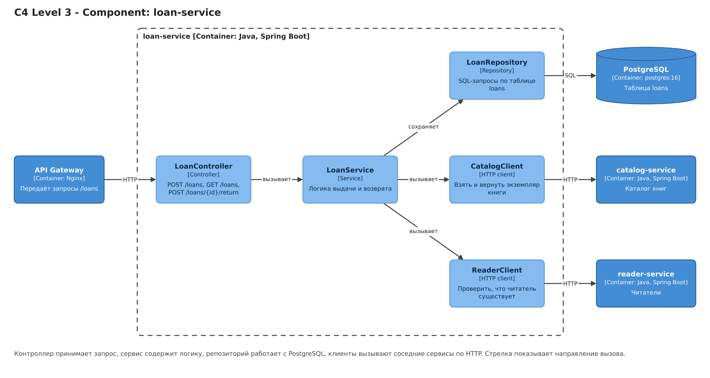

# Библиотечная система: микросервисы + PostgreSQL в Docker Compose

Итоговая контрольная точка. Система из **трёх Java-сервисов**, API Gateway и базы PostgreSQL запускается одной командой `docker compose up`.

## Что это за система

Библиотека: каталог книг, читатели, выдача и возврат книг. Основной сценарий: библиотекарь добавляет книгу и читателя, выдаёт книгу читателю, затем принимает её обратно. При выдаче число доступных экземпляров книги уменьшается, при возврате увеличивается.

## Сервисы

| Сервис | Технология | Порт (хост) | Что делает | Таблица |
|---|---|---|---|---|
| `gateway` | Nginx | 8080 | единая входная точка, направляет запросы по пути | нет |
| `catalog-service` | Java 21, Spring Boot | 8081 | CRUD книг, выдача и приём экземпляров | `books` |
| `reader-service` | Java 21, Spring Boot | 8082 | CRUD читателей | `readers` |
| `loan-service` | Java 21, Spring Boot | 8083 | выдача и возврат, история выдач | `loans` |
| `db` | `postgres:16` | не публикуется | хранение данных, volume `db_data` | - |

Минимум 3 работающих сервиса: **три приложения** (`catalog-service`, `reader-service`, `loan-service`), плюс gateway и база. В `docker compose ps` видны все пять контейнеров.

### Как сервисы взаимодействуют

`loan-service` при выдаче книги сам обращается к двум соседям по HTTP, используя имена сервисов из compose:

1. `GET http://reader-service:8082/readers/{id}` - есть ли читатель (нет - ответ 404);
2. `POST http://catalog-service:8081/books/{id}/take` - забрать один экземпляр (нет книги - 404, экземпляры закончились - 409);
3. сохраняет выдачу в таблицу `loans`. Если сохранить не удалось, экземпляр возвращается в каталог.

При возврате `loan-service` вызывает `POST /books/{id}/return` в `catalog-service`.

Все сервисы подключаются к одной базе `app` в контейнере `db`, у каждого сервиса свои таблицы.

## Структура репозитория

```
library-system/
├── catalog-service/         Java-сервис книг (Dockerfile, pom.xml, src/)
├── reader-service/          Java-сервис читателей (Dockerfile, pom.xml, src/)
├── loan-service/            Java-сервис выдач (Dockerfile, pom.xml, src/)
├── gateway/                 Nginx: Dockerfile и nginx.conf
├── docker-compose.yml       все сервисы, сеть, volume
├── scripts/
│   ├── scenario.sh          проверка API и сценария (curl)
│   └── verify.sh            полная проверка + запись подтверждений в docs/
├── docs/
│   ├── architecture.drawio  схемы C4 (3 страницы: Context, Container, Component)
│   ├── architecture.png     схема C4 Level 2 (Container)
│   ├── architecture-context.png, architecture-component.png
│   ├── architecture.pdf     все три уровня C4
│   ├── postman_collection.json
│   └── compose-ps.txt, scenario-check.txt, persistence-check.txt, compose-logs.txt   (создаёт verify.sh)
└── README.md
```

## Архитектура (C4)

Редактируемый исходник: `docs/architecture.drawio` (открыть на app.diagrams.net, три страницы). Экспорт: `docs/architecture.pdf` (все три уровня) и PNG.

**Level 1 - Context** (`docs/architecture-context.png`): читатель и библиотекарь работают с библиотечной системой.

**Level 2 - Container** (`docs/architecture.png`):


**Level 3 - Component, loan-service** (`docs/architecture-component.png`):



## Docker Compose: сеть, переменные, volume

- **Сеть:** `library-net`, все сервисы в ней. Сервисы находят друг друга по имени (`db`, `catalog-service`, `reader-service`, `loan-service`), Docker DNS превращает имя в адрес контейнера.
- **Переменные окружения** (заданы в `docker-compose.yml`):
  - во всех Java-сервисах: `DB_HOST=db`, `DB_PORT`, `DB_NAME=app`, `DB_USER=postgres`, `DB_PASSWORD`;
  - в `loan-service` дополнительно: `CATALOG_URL=http://catalog-service:8081`, `READER_URL=http://reader-service:8082`;
  - в `db`: `POSTGRES_DB=app`, `POSTGRES_USER=postgres`, `POSTGRES_PASSWORD=1234`.
- **Volume:** `db_data` смонтирован в `/var/lib/postgresql/data`, данные переживают `docker compose down`.
- **depends_on:** сервисы ждут здоровую базу (healthcheck `pg_isready`); `loan-service` дополнительно ждёт запуска `catalog-service` и `reader-service`; `gateway` ждёт все три сервиса.
- **Таблицы** создаются при старте сервисов (`ddl-auto: update`).

## Запуск

Нужен запущенный Docker Desktop. Остановите другие проекты, которые занимают порт 8080 (`docker compose down` в их папках).

```bash
docker compose up --build
```

Первая сборка занимает несколько минут: скачиваются образы и библиотеки Maven. Если скачивание оборвалось, запустите команду повторно.

В другом терминале:

```bash
docker compose ps
docker compose logs
```

Остановка с сохранением данных: `docker compose down`. Полное удаление с данными: `docker compose down -v`.

## Эндпоинты (через gateway, `http://localhost:8080`)

| Метод | URL | Результат |
|---|---|---|
| GET, POST | `/books` | список, создание (201) |
| GET, PUT, DELETE | `/books/{id}` | чтение, изменение, удаление (204) |
| GET, POST | `/readers` | список, создание (201) |
| GET, PUT, DELETE | `/readers/{id}` | чтение, изменение, удаление (204) |
| POST | `/loans` | выдать книгу `{"bookId":1,"readerId":1}` (201) |
| GET | `/loans`, `/loans/{id}` | история выдач |
| POST | `/loans/{id}/return` | принять книгу обратно |

Коды ошибок: 400 - неверные данные, 404 - не найдено (в том числе книга или читатель при выдаче), 409 - нет свободных экземпляров или книга уже возвращена, 502 - соседний сервис недоступен.

## Примеры curl

Данные пишите латиницей: в Git Bash на Windows кириллица в `-d` портится и API отвечает 400.

```bash
# 1. Добавить книгу и читателя
curl -X POST http://localhost:8080/books -H "Content-Type: application/json" \
  -d '{"title":"Crime and Punishment","author":"Fyodor Dostoevsky","publishedYear":1866,"copies":2}'
curl -X POST http://localhost:8080/readers -H "Content-Type: application/json" \
  -d '{"fullName":"Ivan Petrov","email":"ivan.petrov@example.com"}'

# 2. Выдать книгу (взаимодействие loan-service с соседями)
curl -X POST http://localhost:8080/loans -H "Content-Type: application/json" \
  -d '{"bookId":1,"readerId":1}'

# 3. Убедиться, что экземпляров стало меньше (copies: 2 -> 1)
curl http://localhost:8080/books/1

# 4. Принять книгу обратно (copies снова 2)
curl -X POST http://localhost:8080/loans/1/return

# 5. Остальной CRUD
curl http://localhost:8080/books
curl -X PUT http://localhost:8080/books/1 -H "Content-Type: application/json" \
  -d '{"title":"Crime and Punishment","author":"Fyodor Dostoevsky","publishedYear":1866,"copies":5}'
curl -X DELETE http://localhost:8080/books/1
```

Id в ответах могут отличаться от примера, подставляйте реальные. Для Postman импортируйте `docs/postman_collection.json` (переменная `baseUrl` = `http://localhost:8080`).

## Проверка и подтверждения

Автоматически (Git Bash, Linux, macOS или WSL):

```bash
bash scripts/verify.sh
```

Скрипт поднимает систему, выполняет сценарий (`scripts/scenario.sh`, около 40 проверок с отметкой `[OK]`/`[FAIL]`), делает `docker compose down` и `up`, проверяет, что данные на месте, и сохраняет вывод:

| Файл | Что подтверждает |
|---|---|
| `docs/compose-ps.txt` | все сервисы и PostgreSQL запущены |
| `docs/scenario-check.txt` | CRUD книг и читателей, выдача и возврат, ошибки 400/404/409 |
| `docs/persistence-check.txt` | данные сохранились после перезапуска |
| `docs/compose-logs.txt` | вывод `docker compose logs` |

Данные, которые остаются в базе после сценария: книга «Crime and Punishment», читатель «Ivan Petrov» и активная выдача.

Посмотреть таблицы напрямую:

```bash
docker compose exec db psql -U postgres -d app -c "SELECT * FROM books;"
docker compose exec db psql -U postgres -d app -c "SELECT * FROM readers;"
docker compose exec db psql -U postgres -d app -c "SELECT * FROM loans;"
```

## Для защиты

- **Сколько сервисов и какие:** три приложения (каталог, читатели, выдачи), API Gateway на Nginx и PostgreSQL.
- **Как они взаимодействуют:** `loan-service` по HTTP обращается к `reader-service` и `catalog-service` по именам из compose; клиентские запросы идут через gateway.
- **Почему PostgreSQL:** реляционные данные (книги, читатели и выдачи связаны), транзакции, отдельный сервис.
- **Зачем gateway:** единая точка входа, клиент не знает адресов сервисов.
- **Где хранятся данные:** в volume `db_data`, поэтому после `docker compose down` и `up` они на месте.
- **Что делает `depends_on` и healthcheck:** сервисы стартуют только после готовности базы.
- **Что будет, если сосед недоступен:** `loan-service` отвечает 502, а если выдачу не удалось сохранить, экземпляр возвращается в каталог (компенсация).
